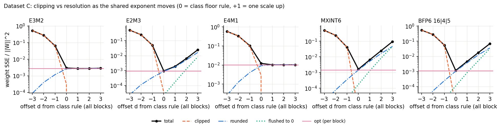

# CS611 Assignment 1, Group 8 (Dataset C, 6-bit)

Picks the best 6-bit format (MXFP6 E3M2 / E2M3 / E4M1, MXINT6, BFP6) for W_C,
using a histogram-based predictor instead of brute-force quantization.

## Requirements
Python 3.8+ and numpy; matplotlib for the figures; tqdm optional for progress bars:

    python -m pip install numpy matplotlib tqdm

## Data
Put `W_C.npy` and `X_cal.npy` in `data/` (already included), or pass
`--data <folder>` to any script.

## Run everything (one command)
    python3 run_all.py              # tests, baselines, all tables, figures, manifest (~5 s)
    python3 run_all.py --npz path/assignment_data.npz   # + datasets A-E context tables

Outputs: `results/tables/T1..T8.md/.csv`, `results/baseline_C*.csv/.json`, `figures/`,
`results/logs/`, `results/RUN_MANIFEST.md`. Steps are checkpointed (`--fresh` recomputes).

## Run one piece
    python3 test_formats.py         # unit tests for the quantizers (30 tests)
    python3 run_baseline.py         # exhaustive baseline -> results/baseline_C.csv/.json (--variants, --mode wx)
    python3 validate_predictor.py   # main result: predictor vs brute force, accuracy and cost
    python3 explore.py              # brute-force table, scale search, X_cal split, sensitivity
    python3 make_figures.py         # report figures into figures/ (needs: pip install matplotlib)

## Files
- `formats.py`: the five quantizers (+ 6 sensitivity variants), scale policies ocp/ceil/opt, W+X mode, metrics, exhaustive harness (API: `FORMATS_API.md`; how it works: `docs/QUANTIZERS.md`)
- `run_all.py`: regenerates every table and figure
- `test_formats.py`: unit tests; `run_baseline.py`: exhaustive ground truth for the selector
- `predictor.py`: the format-selection algorithm (histogram + XX^T metric)
- `validate_predictor.py`: checks the predictor on W_C and 90 synthetic matrices
- `explore.py`: exhaustive baseline and the outlier / sparsity / scale experiments
- `make_figures.py`: generates the four report figures
- `report/`: draft report (`report_draft.docx`) and its builder script
- `data.py`: data loading; `scipy_free_stats.py`: rank-correlation helper

Format conventions follow the class (Lecture 19 notebook, board notes) and the team
decisions D1-D11 (BFP6 = 16|4|5, E4M1 vmax 384, ...). They are listed with sources in
`docs/QUANTIZERS.md` and the docstring at the top of `formats.py`.

## Use the predictor on your own matrices
    from predictor import select
    best, scores = select(W, X)

## Scale-optimization study (Anuj Chaudhary)

How much does the choice of the shared exponent matter, and does it change which format wins?

### Run
    python3 test_scale_opt.py       # 16 tests, including the two hand examples below
    python3 scale_study.py          # cross-checks + all tables -> results/scale_study.md, results/scale_study_<tag>.csv,
                                    # figure -> figures/fig5_scale_tradeoff.png  (about 25 s for C)
    python3 scale_study.py --npz assignment_data.npz   # datasets A-E from the course file (W_A ... W_E, X_cal)

Without `--npz`, the course file is looked up like `run_all.py` does (`$CS611_DATA`, then `data/assignment_data.npz`); if it is missing, only C is studied. `run_all.py` runs `scale_study.py` automatically when the file exists.

### Files
- `scale_opt.py`: independent implementation of the shared-exponent policies. It does not import `formats.py`, and it uses a different method on purpose (grid lookup for rounding, `ceil` derived as e_ocp or e_ocp + 1 by checking which elements would clip), so it can cross-check `formats.py`. Candidates follow the locked decisions: BFP6 = 16|4|5 (D1, sign + magnitude, 4-bit exponent clamped to [-8, 7]) and MXINT6 = two's complement k in [-32, 31] (D10, revised 23 Oct). Variants: `MXINT6_sym` [-31, 31], `MXFP6_E4M1_v192`, `MXFP6_E4M1_nan1`, `BFP6_g32e8` (= `MXINT6_sym`), `BFP6_b32_ceil` (v1's BFP6). Counters use the Lecture 19 definitions: `n_range` (out of range before rounding) and `n_saturated` (the rounded value is beyond vmax). An integer code has one zero, so MXINT6 decodes a small negative weight to +0.
- `test_scale_opt.py`: unit tests (grids, RNE ties, -0, exact floor(log2), range vs saturated, two's complement, clamps, tail block, policy properties, hand examples).
- `scale_study.py`: the study; every number below comes from `results/scale_study.md`.

### Policies compared
| policy | what it does | roundings per weight |
|---|---|---|
| `ocp` | class floor rule, e = floor(log2 max) - emax | 1 |
| `ceil` | smallest power-of-two scale that clips nothing | 1 |
| `opt` | per block try e_ocp (clamped to the exponent field) + {-2, -1, 0, +1}, keep lowest weight SSE | 4 |
| `opt_wide` / `oracle_w` | same with -3..+2 / -8..+8 | 6 / 17 |
| `model` | same window, error predicted without rounding (exact clip/flush, step^2/12 otherwise) | 0 |
| `opt_out` | window -2..+1, output-aware r^T H_bb r, H from the even (fit) columns | 4 |
| `oracle_y` | all exponents of a row chosen jointly for r^T H r with the full H, fit columns | 6 |
| `bound_y` | as `oracle_y` but fitted on the held-out columns: a bound, not a usable policy | 6 |

### Results on dataset C (relative error of Y = W X on the held-out odd columns, %)
| format | bits/elem | ocp (class) | ceil | **opt** | model | opt_out | oracle_y | bound_y |
|---|---|---|---|---|---|---|---|---|
| **E2M3** | 6.32 | **3.101** | **3.130** | **3.076** | **3.082** | **3.080** | **3.118** | **3.064** |
| BFP6 16\|4\|5 | 6.28 | 3.484 | 3.595 | 3.437 | 3.432 | 3.436 | 3.516 | 3.389 |
| MXINT6 (two's complement) | 6.32 | 4.054 | 4.160 * | 3.880 | 3.893 | 3.910 | 3.919 | 3.852 |
| E3M2 | 6.32 | 5.469 | 5.257 | 5.257 | 5.257 | 5.258 | 5.266 | 5.228 |
| E4M1 | 6.32 | 11.149 | 10.237 | 10.237 | 10.237 | 10.229 | 10.231 | 10.197 |

\* With `formats.py`'s and Siddhant's reading of `ceil` (move up when amax > (31/16) 2^e whatever its sign) it is 4.174; see finding 3 below.

On all 256 columns the class-rule / opt numbers are E2M3 3.079 / 3.058, BFP6 3.464 / 3.403, MXINT6 4.048 / 3.850, E3M2 5.439 / 5.236, E4M1 11.088 / 10.176, the same as Siddhant's reference (`verification/AGREEMENT_REPORT.md`).

**Variants, held-out Y error % (ocp / ceil / opt):** MXINT6_sym, BFP6 32|8|5 and v1's BFP6 4.054 / 4.174 / 3.938 (identical); E4M1 one-NaN (vmax 256) 20.662 / 10.237 / 10.237; E4M1 v192 11.149 / 10.237 / 10.237.

**MXINT6 two's complement vs symmetric (D10) is a scale-search effect.** Under the class rule the extra code -32 is almost never reached (4.054 for both). Under `opt` two's complement is better (3.880 vs 3.938): at d = -1 a negative block maximum clips at -2^E instead of -(31/32) 2^E, so shrinking the scale costs less. Two's complement shrinks the scale in 35 blocks instead of 27, and the 8 extra blocks all have a negative maximum (21 vs 13).

- **Gain of `opt` over the class rule (held-out):** E3M2 3.9%, E2M3 0.8%, E4M1 8.2%, MXINT6 4.3%, BFP6 1.3%. In percentage points with paired-bootstrap 95% intervals over the held-out columns: E2M3 +0.024 [+0.014, +0.035], MXINT6 +0.174 [+0.131, +0.215], BFP6 +0.046 [+0.019, +0.073], E3M2 +0.212 [+0.176, +0.248], E4M1 +0.911 [+0.802, +1.022]. All exclude 0.
- **The ranking never changes:** E2M3 < BFP6 < MXINT6 < E3M2 < E4M1 under all nine rules (the eight policies and the bound); the gap between the winner and the runner-up has a 95% interval excluding 0 every time (`ocp`: 0.383 [0.325, 0.440], `opt`: 0.361 [0.304, 0.413]).
- **A wider window does not help:** `opt_wide` and `oracle_w` (-8..+8) pick exactly the same exponents as `opt`. The searches only use d in {0, +1} for the FP formats and d in {-1, 0, +1} for MXINT6/BFP6; d = -2 is never chosen.
- **The output-aware objective does not help; it overfits.** `opt_out` is within 0.01 percentage points of `opt` for E2M3, BFP6, E3M2 and E4M1; for MXINT6 it ties `opt` on the fit columns (3.818 vs 3.819) but is worse held-out (3.910 vs 3.880). The joint `oracle_y` is best on the columns it was fitted on and worse on the held-out ones (E2M3: 3.024 fit / 3.118 held-out vs `opt` 3.040 / 3.076): it uses the noisy off-diagonal terms of X_fit X_fit^T (128 columns for 100 inputs). X_cal is nearly white, so weight error is the right objective.
- **Little headroom left:** even `bound_y`, fitted on the held-out columns themselves, only reaches 3.064 for E2M3 vs 3.076 for `opt`.
- **The no-rounding `model` picks the same exponent as `opt` in 92.0-98.8% of blocks** and is within 0.013 percentage points of it held-out, so `opt` can be predicted without rounding anything.

### Why: clipping versus resolution
Block max a, E = floor(log2 a), mantissa of the max m = a / 2^E in [1, 2). The class rule puts the max at m * 2^emax on the element grid; the largest element is vmax = r * 2^emax.

1. **The floor rule clips when m > r**, and r < 2 for every candidate: E2M3 1.875, E3M2 1.75, E4M1 1.5 (r = 2 - 2^-mb, all mantissa codes of the top binade are finite), BFP6 and a positive MXINT6 maximum 31/16 = 1.9375. A negative MXINT6 maximum has r = 2 (code -32), so it is never clipped. The clip error is (m - r) * 2^E < 2^(E - mb): up to one full step, twice the worst rounding error.
2. **How often:** if log2 a is spread evenly within a binade, P(m > r) = log2(2/r). Predicted vs observed share of clipped blocks on W_C: E4M1 41.5% / 40.0%, E3M2 19.3% / 19.5%, E2M3 9.3% / 10.0%, BFP6 4.6% / 4.4%, MXINT6 2.5% / 3.5% (only the 218 of 400 blocks with a positive maximum can clip). The E4M1 one-NaN variant (vmax 256) has r = 1, so nearly every block clips: 20.662% held-out under the class rule vs 11.149% for vmax 384.
3. **What one exponent up costs:** an FP weight in the normal range has absolute step 2^(floor(log2|w|) - mb), independent of the scale, so only weights that drop into the subnormal range get coarser. The normal range spans 3 binades for E2M3, 7 for E3M2, 15 for E4M1. For INT/BFP the step is scale/16, so every weight gets coarser. Share of the other weights in clipped blocks whose step doubles: E4M1 0.0%, E3M2 7.1%, E2M3 61.6%, MXINT6 100%, BFP6 100%.

   | clipped blocks only | clip SSE at e_ocp | same weights at e_ocp+1 | other weights' change | net from going up |
   |---|---|---|---|---|
   | E3M2 | 3.1716 | 0.9037 | +0.0012 | -2.2667 (helps) |
   | E4M1 | 29.8633 | 9.9800 | +0.0000 | -19.8833 (helps) |
   | E2M3 | 0.3626 | 0.1140 | +0.3597 | +0.1112 (hurts) |
   | MXINT6 | 0.0371 | 0.0491 | +0.6954 | +0.7075 (hurts) |
   | BFP6 16\|4\|5 | 0.0549 | 0.0909 | +0.6680 | +0.7040 (hurts) |

   This is why `ceil` helps E3M2/E4M1 and hurts E2M3/MXINT6/BFP6. It also explains why E4M1 with vmax 384, 192 or 256 gives the same held-out error under `ceil` (10.237%): when nothing clips, only weights in the subnormal range can quantize differently, and E4M1 has almost none (a handful of tiny weights differ).
4. **The integer formats prefer a smaller scale (d = -1):** every step halves but the clip level drops to c * 2^E, with c = 31/32 for a positive maximum and for BFP6, and c = 1 for a negative MXINT6 maximum (code -32). With one weight above it and uniform rounding noise, d = -1 wins when (m - c)^2 < 2^-8 ((N - 1)/16 + 1/12), N = block size, i.e. m < m*. MXINT6, positive maximum: m* = 1.058, predicted 18 blocks, observed 14; negative maximum: m* = 1.089, predicted 22, observed 21. BFP6: m* = 1.032, predicted 32, observed 31. For FP formats d = -1 buys nothing for normal weights, so it is never chosen.

### Hand examples (checked by `test_scale_opt.py`)
- **MXINT6**, x = [4.05, 0.3, -0.6, 0.2, 0.9, -0.1, 0.45, 1.1], class exponent e = 2. SSE at e = 1 / 2 / 3: **0.040625** / 0.050 / 0.125. At e = 1 the outlier is clipped to 3.875, but the other seven weights get half the step (their SSE falls from 0.0475 to 0.0100), so `opt` picks e = 1.
- **E2M3**, x = [3.9, 0.3, -0.2, 0.1, 1.3, -0.7, 0.45, 2.2], class exponent e = -1 clips 3.9 to 3.75. SSE at e = -1 / 0: 0.028750 / **0.025625**. The normal weights 1.3 and 2.2 quantize identically at both exponents; only the weights that become subnormal (0.3, -0.2, -0.7, 0.45) get coarser.

### Cross-checks
`scale_study.py` writes all of them to section 1 of `results/scale_study.md`.
- **`formats.py`**: bit-exact comparison on 7 matrices (W_C, Gaussian, Laplace, Student-t, 70% sparse, rows scaled 1e+-6, FP32 maxima at and just below powers of two) under ocp, ceil, opt, opt with H and the +-3 search; formats are matched by definition, so the check works with v1, v2 and after D10 lands in `formats.py`. Against v2 (branch `akash/formats-v2`, re-run 23 Oct): 0 differing elements for all candidates and variants except two's-complement MXINT6 under `ceil` (finding 3); counters on W_C agree in 29 of 30 cases (the same exception); v2's tables T1, T3, T4 and T6 for C have the same numbers. The committed `results/scale_study.md` is generated against the `formats.py` on main (v1 until v2 is merged): rerun `python scale_study.py` after the merge.
- **Siddhant's reference** (`verification/reference_impl.py`, exact fractions): on W_C, 0 differing elements and 0 signed-zero differences for every format and variant under ocp, ceil and opt, except two's-complement MXINT6 under `ceil` (50 weights).

Findings:
1. `np.floor(np.log2(a))` rounds up for a float64 a few ulps below a power of two (a = 7.999999999999999 gave E2M3 exponent 1 instead of 0). It cannot happen for FP32 data (0 of 253 powers of two), so no result changed; fixed in `formats.py` with `np.frexp(a)[1] - 1` (commit 32530fa). `predictor.py` still uses `np.floor(np.log2(...))`, which is harmless on FP32 data.
2. When the BFP6 4-bit exponent clamp binds, `scale_opt.py` used to search around the unclamped exponent, so the search collapsed to one candidate; v2 and the reference search around the clamped exponent, and `scale_opt.py` now does the same. Never matters on C (the clamp never binds there).
3. **Open decision:** two's-complement MXINT6 under `ceil`. `formats.py` and the reference move the scale up whenever amax > (31/16) 2^e, whatever its sign; a negative maximum down to -2 * 2^e fits the code -32, so nothing clips, and `scale_opt.py` keeps the lower scale (the literal "smallest scale that clips nothing"). Held-out 4.160 vs 4.174. Since D10 makes two's complement the candidate, the `ceil` column of the main tables depends on this choice; the class rule and `opt` agree.
4. MXINT6 zero: an integer code has one zero, so `scale_opt.py` and the reference decode a small negative weight to +0; `formats.py` returns -0. Numerically identical.

### Limitations
- Only dataset C so far; A-E need the course file (`--npz assignment_data.npz`).
- The bootstrap resamples X columns with W fixed: it shows stability to the choice of input columns, not to a different W.
- `model` and the m* rule assume uniform rounding noise (step^2/12).
- The output-aware conclusions rely on X_cal being nearly white; a strongly correlated X_test could change them.
- `oracle_y` uses coordinate descent: checked against full enumeration for the four MX formats (identical for E3M2, E4M1, MXINT6; E2M3 differs in 2/100 rows, objective gap 0.0234%); not enumerated for BFP6.
- The BFP6 4-bit exponent clamp never binds on C, so it is exercised only by unit tests and the cross-check matrices.
